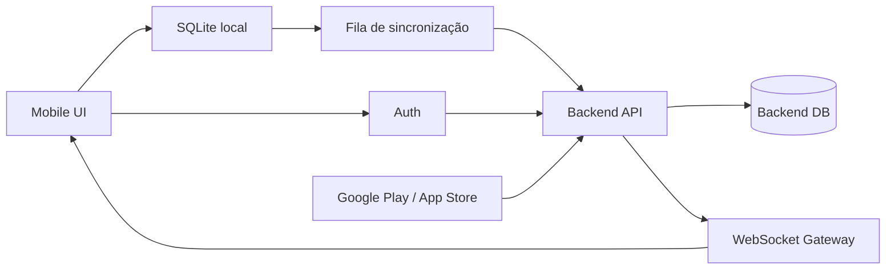
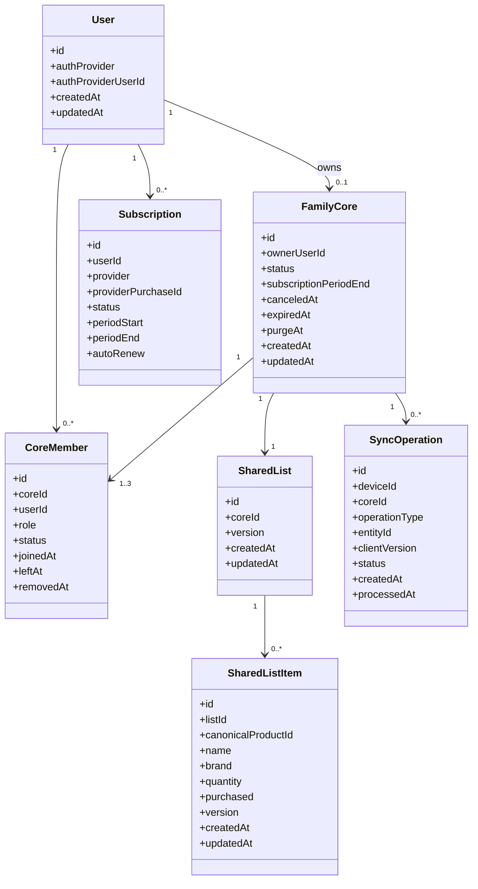
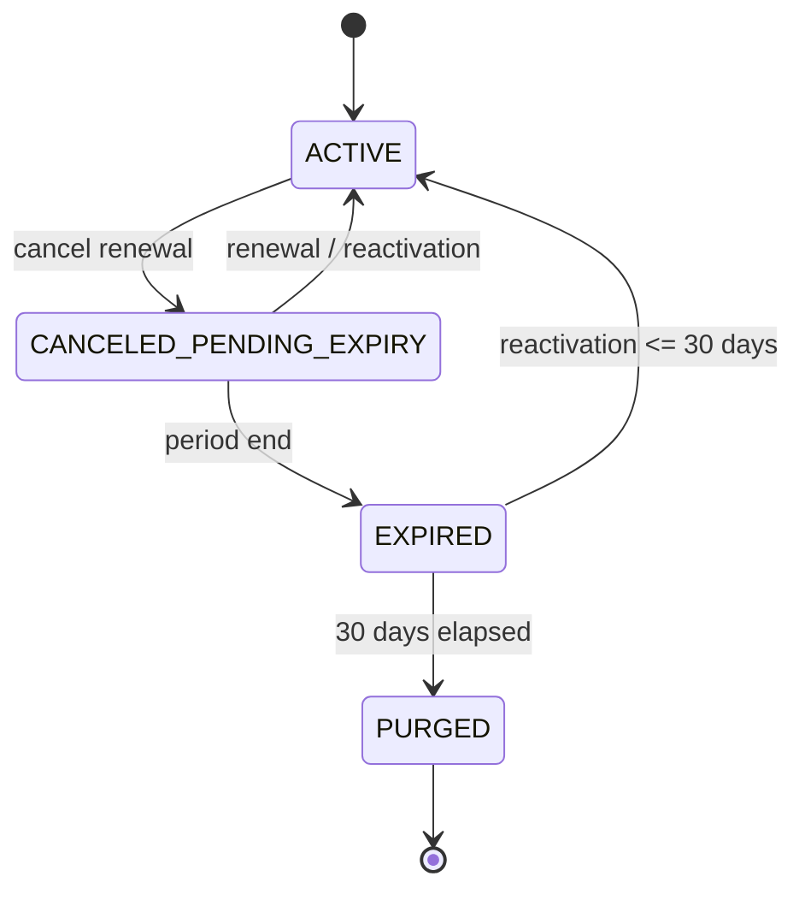
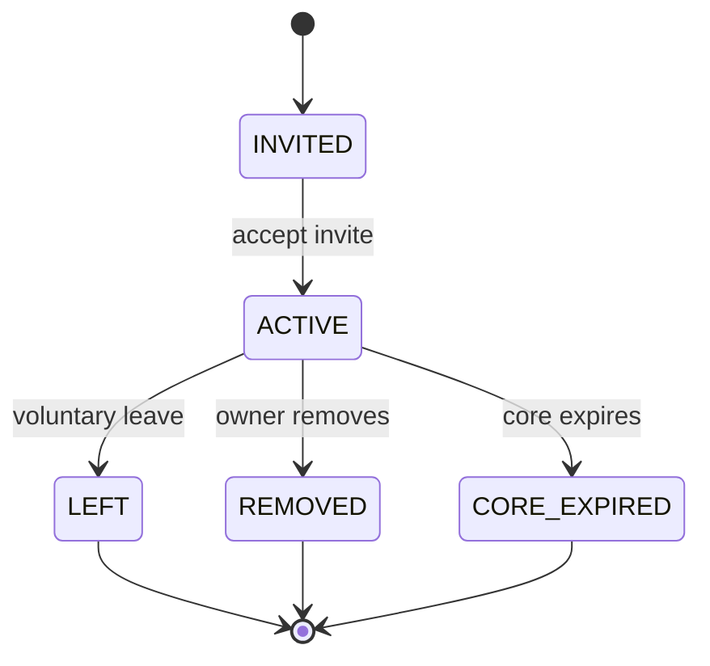

# MercadoFácil — Core Familiar
## Especificação de Engenharia de Software, Arquitetura, Dados, UML, ADRs e Guia de Implementação

> **Status:** especificação de implementação  
> **Escopo:** Core Familiar, sincronização da lista compartilhada, assinatura e benefícios associados  
> **Objetivo:** servir como contrato técnico para um agente de desenvolvimento (ex.: Antigravity) implementar, testar e refatorar o Core Familiar sem alterar regras de negócio sem autorização.

---

# 1. Instruções obrigatórias para o agente

Antes de modificar código:

1. Leia este documento inteiro.
2. Inspecione a implementação existente.
3. Não presuma nomes de arquivos, tabelas, endpoints ou componentes.
4. Faça um mapa entre esta especificação e o código atual.
5. Identifique divergências entre a especificação e a implementação.
6. Não reescreva módulos inteiros quando uma alteração localizada for suficiente.
7. Preserve funcionalidades existentes que não estejam explicitamente sendo alteradas.
8. Não altere regras de negócio sem registrar a mudança e solicitar confirmação.
9. Nunca trate estado local do cliente como fonte de autoridade para autorização.
10. O backend deve validar todas as permissões do Core.
11. Não armazenar no backend os arquivos originais dos encartes.
12. Não criar sincronização baseada exclusivamente em WebSocket.
13. Toda alteração local de lista compartilhada deve sobreviver a:
    - perda de internet;
    - fechamento do app;
    - reinicialização do dispositivo;
    - reconexão posterior.
14. Toda alteração remota deve ser idempotente.
15. Não fazer uma grande alteração de uma vez. Implementar em etapas pequenas e verificáveis.
16. Depois de cada etapa, executar testes e relatar:
    - arquivos alterados;
    - comportamento esperado;
    - testes executados;
    - resultado;
    - pendências.

## Regra de ouro

**Não implementar "parece funcionar". Implementar de acordo com invariantes, autorização, persistência, sincronização e critérios de aceitação definidos neste documento.**

---

# 2. Visão do produto

O Core Familiar é um grupo privado de usuários que compartilha uma lista de compras.

O Core possui:

- um responsável/pagador;
- até dois membros adicionais, conforme o modelo atual do produto;
- uma lista compartilhada;
- sincronização entre dispositivos;
- benefícios associados à assinatura;
- QR Codes para entrada de membros;
- regras de saída, remoção, cancelamento e expiração.

A assinatura do Core está vinculada à conta do responsável e à compra realizada pela Google Play ou App Store.

O Core não possui nome.

Os QR Codes são serializados e específicos para o fluxo de convite/conexão de cada integrante.

---

# 3. Objetivos funcionais

O sistema deve permitir:

1. Criar um Core mediante assinatura válida.
2. Conectar membros ao Core.
3. Compartilhar uma lista entre os membros autorizados.
4. Editar a lista online ou offline.
5. Sincronizar alterações quando houver conexão.
6. Notificar conflitos de edição.
7. Mesclar itens duplicados.
8. Revogar acesso imediatamente quando um membro sair ou for removido.
9. Revogar imediatamente benefícios dependentes do Core.
10. Manter o acesso até o fim do período já pago quando a renovação for cancelada.
11. Encerrar o Core quando a assinatura efetivamente expirar.
12. Permitir reativação do Core dentro da janela de retenção definida.
13. Recuperar o Core do responsável em outro dispositivo usando a mesma conta.
14. Permitir recuperação automatizada da conta.
15. Disponibilizar suporte por e-mail apenas para casos extremos de perda completa de acesso.
16. Permitir que listas sejam preservadas localmente após saída/remoção/encerramento, mediante escolha do usuário.
17. Manter os encartes fora do backend.

---

# 4. Regras de negócio

## 4.1 Responsável

O responsável:

- é quem possui a assinatura;
- é o titular do Core;
- não pode simplesmente "sair" do Core enquanto a assinatura estiver ativa;
- para deixar de ser responsável, deve cancelar a assinatura;
- continua responsável até o fim do período pago;
- pode recuperar o Core em outro aparelho entrando na mesma conta;
- não transfere a titularidade do Core para outro usuário.

## 4.2 Membros

Membros podem:

- entrar mediante mecanismo de convite/QR Code;
- visualizar a lista;
- adicionar itens;
- editar itens;
- alterar quantidades;
- marcar itens como comprados;
- desmarcar itens;
- remover itens, conforme permissões da implementação;
- sair voluntariamente.

Ao sair:

- perde acesso à lista compartilhada;
- perde imediatamente todos os benefícios do Core;
- mantém, se escolher, uma cópia local da lista;
- não transfere titularidade do Core.

## 4.3 Remoção pelo responsável

Quando um membro é removido:

- a revogação é imediata;
- o membro não pode continuar acessando a lista compartilhada;
- a autorização deve ser rejeitada pelo backend;
- se estiver offline, ao reconectar deve descobrir que perdeu o acesso;
- deve perder todos os benefícios do Core;
- pode escolher preservar uma cópia local da lista ou descartá-la.

## 4.4 Cancelamento

Cancelar a renovação não encerra imediatamente o Core.

Ao cancelar:

- registrar o cancelamento;
- manter Core e benefícios até o `subscription_period_end`;
- mostrar imediatamente:
  > "A assinatura do Core Familiar foi cancelada. Os benefícios se encerram em DD/MM/AAAA."

Cinco dias antes do encerramento:

> "Os benefícios do Core Familiar se encerram em 5 dias."

Não exibir mensagens redundantes.

## 4.5 Expiração

Quando a assinatura efetivamente expirar:

- Core entra em estado encerrado;
- benefícios são revogados;
- membros perdem acesso à lista compartilhada;
- cada membro pode escolher:
  - manter cópia local;
  - descartar a lista.

O Core encerrado permanece recuperável por **30 dias**.

Após 30 dias:

- dados persistidos do Core podem ser eliminados conforme política de retenção;
- o Core não deve ser recuperável;
- membros podem criar outro Core.

## 4.6 Reativação

Se o responsável renovar/reativar dentro dos 30 dias:

- reativar o Core anterior;
- restaurar membros válidos;
- restaurar a lista persistida;
- restaurar benefícios conforme a assinatura válida;
- gerar/reativar mecanismos de convite conforme necessário.

Não é permitida transferência de titularidade.

## 4.7 Perda do dispositivo

A conta e o Core não pertencem ao aparelho.

Se o responsável:

- perder o celular;
- trocar de aparelho;
- desinstalar o app;
- reinstalar o app;

deve conseguir recuperar o Core entrando na mesma conta.

A recuperação deve ser automatizada.

Não criar processo de transferência de titularidade.

Para casos extremos de perda completa do acesso à conta, disponibilizar canal de suporte por e-mail.

---

# 5. Regras de assinatura e benefícios

O estado efetivo dos benefícios deve ser derivado da combinação:

- identidade do usuário;
- assinatura;
- estado do Core;
- relação do usuário com o Core;
- compras individuais de benefícios.

## 5.1 Benefício sem anúncios

Se o usuário possui sem anúncios somente por causa do Core:

- remover do Core => anúncios voltam;
- sair do Core => anúncios voltam;
- Core expira => anúncios voltam.

Se possui compra individual válida de sem anúncios:

- Core não pode revogar essa compra.

Portanto:

```text
sem_anuncios_efetivo =
    compra_individual_valida
    OR
    (membro_core_ativo AND assinatura_core_valida)
```

## 5.2 Benefícios do Core

Todos os benefícios exclusivamente derivados do Core devem desaparecer quando:

- usuário sair;
- usuário for removido;
- Core expirar;
- assinatura perder validade.

---

# 6. Modelo de estados

## 6.1 Estado do Core

```text
ACTIVE
  |
  | cancel renewal
  v
CANCELED_PENDING_EXPIRY
  |
  | subscription_period_end reached
  v
EXPIRED
  |
  | <= 30 days + valid renewal
  v
ACTIVE
  |
  | > 30 days
  v
PURGED
```

O estado `CANCELED_PENDING_EXPIRY` continua funcional.

O cancelamento da renovação não equivale à revogação imediata.

## 6.2 Estado do membro

```text
INVITED
  |
  v
ACTIVE
  |
  +---- voluntary leave ----> LEFT
  |
  +---- owner removal ------> REMOVED
  |
  +---- core expiration ----> CORE_EXPIRED
```

Um membro que esteja em `LEFT`, `REMOVED` ou `CORE_EXPIRED` não possui autorização para acessar a lista compartilhada.

---

# 7. Arquitetura lógica

## 7.1 Princípios

### Fonte de verdade

Para autorização:

> **Backend**

Para lista compartilhada:

> **Backend + SQLite local + sincronização**

Para lista individual:

> **SQLite local**

Para encartes:

> **SQLite/local storage do dispositivo**

Para eventos em tempo real:

> **WebSocket**

Para persistência offline:

> **SQLite + fila de operações pendentes**

## 7.2 Regra importante

WebSocket **não é mecanismo de persistência**.

A arquitetura deve ser:

```text
SQLite local
    |
    | operação pendente
    v
Sync Queue
    |
    | HTTPS / protocolo de sincronização
    v
Backend
    |
    +--> Banco persistente
    |
    +--> WebSocket --> clientes conectados
```

Se o dispositivo estiver offline:

```text
UI
 |
 v
SQLite
 |
 v
Sync Queue
 |
 X internet
```

Quando a conexão retornar:

```text
Sync Queue
 |
 v
Backend
 |
 v
confirmação
 |
 v
operação marcada como sincronizada
```

---

# 8. Componentes



---

# 9. UML — casos de uso

```mermaid
flowchart TB
    Owner((Responsável))
    Member((Membro))
    System[MercadoFácil]

    Owner --> UC1[Criar Core]
    Owner --> UC2[Assinar Core]
    Owner --> UC3[Cancelar renovação]
    Owner --> UC4[Gerar QR Code]
    Owner --> UC5[Remover membro]
    Owner --> UC6[Recuperar Core]
    Owner --> UC7[Reativar Core]

    Member --> UC8[Entrar no Core]
    Member --> UC9[Sair do Core]
    Member --> UC10[Editar lista]
    Member --> UC11[Marcar item comprado]
    Member --> UC12[Sincronizar lista]

    System --> UC13[Validar assinatura]
    System --> UC14[Persistir lista compartilhada]
    System --> UC15[Sincronizar via WebSocket]
    System --> UC16[Revogar acesso]
    System --> UC17[Resolver conflito]
```



---

# 10. UML — entidades



> Os nomes acima são modelos conceituais. O agente deve mapear para as entidades existentes antes de criar novas tabelas.

---

# 11. DML / modelo de dados

## 11.1 Tabelas conceituais

### users

Identidade do usuário.

Campos mínimos:

```sql
id
auth_provider
auth_provider_user_id
created_at
updated_at
```

### family_cores

```sql
id
owner_user_id
status
subscription_period_end
canceled_at
expired_at
purge_at
created_at
updated_at
```

### core_members

```sql
id
core_id
user_id
role
status
joined_at
left_at
removed_at
created_at
updated_at
```

### shared_lists

```sql
id
core_id
version
created_at
updated_at
```

### shared_list_items

```sql
id
list_id
canonical_product_id NULL
name
brand NULL
quantity
purchased
version
created_at
updated_at
```

### sync_operations

```sql
id
core_id
user_id
device_id
operation_id
operation_type
entity_type
entity_id
payload
client_version
status
created_at
processed_at
```

### subscriptions

```sql
id
user_id
provider
provider_purchase_id
status
period_start
period_end
auto_renew
created_at
updated_at
```

## 11.2 Restrições

O banco deve garantir:

```text
FamilyCore.owner_user_id -> User
CoreMember.core_id -> FamilyCore
CoreMember.user_id -> User
SharedList.core_id -> FamilyCore
SharedListItem.list_id -> SharedList
Subscription.user_id -> User
```

Regras:

- um Core possui exatamente um responsável;
- um usuário não pode ser membro ativo do mesmo Core duas vezes;
- somente membros ativos podem acessar SharedList;
- somente o responsável pode remover membros;
- somente o responsável pode alterar o estado da assinatura;
- operações de sincronização devem possuir identificador idempotente.

---

# 12. SQL conceitual

> Não executar cegamente. Adaptar à tecnologia/banco já existente.

```sql
CREATE TABLE family_cores (
    id TEXT PRIMARY KEY,
    owner_user_id TEXT NOT NULL,
    status TEXT NOT NULL,
    subscription_period_end TEXT,
    canceled_at TEXT,
    expired_at TEXT,
    purge_at TEXT,
    created_at TEXT NOT NULL,
    updated_at TEXT NOT NULL
);

CREATE TABLE core_members (
    id TEXT PRIMARY KEY,
    core_id TEXT NOT NULL,
    user_id TEXT NOT NULL,
    role TEXT NOT NULL,
    status TEXT NOT NULL,
    joined_at TEXT NOT NULL,
    left_at TEXT,
    removed_at TEXT,
    created_at TEXT NOT NULL,
    updated_at TEXT NOT NULL,
    UNIQUE(core_id, user_id)
);

CREATE TABLE shared_lists (
    id TEXT PRIMARY KEY,
    core_id TEXT NOT NULL UNIQUE,
    version INTEGER NOT NULL DEFAULT 0,
    created_at TEXT NOT NULL,
    updated_at TEXT NOT NULL
);

CREATE TABLE shared_list_items (
    id TEXT PRIMARY KEY,
    list_id TEXT NOT NULL,
    canonical_product_id TEXT,
    name TEXT NOT NULL,
    brand TEXT,
    quantity INTEGER NOT NULL,
    purchased INTEGER NOT NULL DEFAULT 0,
    version INTEGER NOT NULL DEFAULT 0,
    created_at TEXT NOT NULL,
    updated_at TEXT NOT NULL
);
```

---

# 13. DML de exemplo

Criar Core:

```sql
INSERT INTO family_cores (
    id,
    owner_user_id,
    status,
    created_at,
    updated_at
)
VALUES (
    :core_id,
    :owner_user_id,
    'ACTIVE',
    :now,
    :now
);
```

Adicionar membro:

```sql
INSERT INTO core_members (
    id,
    core_id,
    user_id,
    role,
    status,
    joined_at,
    created_at,
    updated_at
)
VALUES (
    :member_id,
    :core_id,
    :user_id,
    'MEMBER',
    'ACTIVE',
    :now,
    :now,
    :now
);
```

Adicionar item:

```sql
INSERT INTO shared_list_items (
    id,
    list_id,
    name,
    quantity,
    purchased,
    version,
    created_at,
    updated_at
)
VALUES (
    :item_id,
    :list_id,
    :name,
    :quantity,
    0,
    1,
    :now,
    :now
);
```

Marcar comprado:

```sql
UPDATE shared_list_items
SET
    purchased = 1,
    version = version + 1,
    updated_at = :now
WHERE id = :item_id
  AND list_id = :list_id;
```

Remover membro:

```sql
UPDATE core_members
SET
    status = 'REMOVED',
    removed_at = :now,
    updated_at = :now
WHERE core_id = :core_id
  AND user_id = :user_id
  AND status = 'ACTIVE';
```

---

# 14. Sincronização offline-first

## 14.1 Princípio

Toda alteração de lista compartilhada deve primeiro ser aplicada localmente.

Exemplo:

```text
Usuário toca "comprado"
        |
        v
Atualiza SQLite local
        |
        v
Cria SyncOperation
        |
        +---- internet disponível ----> Backend
        |
        +---- sem internet ------------> permanece pendente
```

## 14.2 Requisitos

Uma operação deve possuir:

- `operation_id` único;
- `device_id`;
- `user_id`;
- `core_id`;
- timestamp lógico ou versão;
- tipo da operação;
- entidade afetada;
- payload mínimo necessário.

O servidor deve processar a operação de forma idempotente.

Enviar a mesma operação duas vezes não pode duplicar o efeito.

---

# 15. WebSocket

WebSocket é responsável por **notificação em tempo real**, não por persistência.

Fluxo:

```text
Cliente A
  |
  | alteração
  v
Backend
  |
  +--> persiste alteração
  |
  +--> publica evento
          |
          +--> Cliente B
          +--> Cliente C
```

Se B ou C estiverem offline:

```text
Backend
  |
  X WebSocket indisponível
```

Nada deve ser perdido porque a alteração já está persistida.

Ao reconectar:

```text
Cliente
  |
  | envia lastKnownVersion
  v
Backend
  |
  | retorna alterações posteriores
  v
Cliente
```

---

# 16. Modelo de versão

A lista compartilhada deve possuir uma versão monotônica:

```text
version 100
version 101
version 102
...
```

Cada alteração aceita pelo servidor produz nova versão.

O cliente informa:

```text
lastKnownVersion = 101
```

Se o servidor está em 105:

```text
retornar 102, 103, 104, 105
```

Depois disso o cliente fica sincronizado.

---

# 17. Conflitos

## 17.1 Dois usuários alterando o mesmo item offline

Exemplo:

```text
Estado original:
Pasta de dente = 2
```

Usuário A offline:

```text
quantidade = 3
```

Usuário B offline:

```text
quantidade = 5
```

Ao sincronizar:

- detectar conflito;
- não sobrescrever silenciosamente;
- registrar as duas versões;
- notificar o usuário apropriado;
- permitir consenso.

## 17.2 Regra de UX

O usuário deve receber uma mensagem objetiva, por exemplo:

> "A quantidade de Pasta de dente foi alterada por outro integrante. Escolha qual quantidade manter."

Opções:

```text
Manter 3
Manter 5
```

## 17.3 Produtos duplicados

Se dois integrantes adicionarem o mesmo produto offline:

```text
A: Arroz x 2
B: Arroz x 3
```

O sistema deve reconhecer o mesmo produto e mesclar.

Resultado:

```text
Arroz x 5
```

Se houver divergência que não seja simplesmente uma soma válida, deve existir resolução explícita.

A identidade do produto deve ser baseada no identificador/catálogo normalizado quando disponível, e não somente em comparação textual ingênua.

---

# 18. Estado comprado

Cada item possui:

```text
purchased = false
```

ou

```text
purchased = true
```

Ao marcar comprado:

- atualizar imediatamente localmente;
- sincronizar;
- notificar outros membros;
- refletir visualmente:
  - item transparente;
  - texto tachado;
  - estado de comprado.

A alteração deve ser visível em tempo real para os outros dispositivos conectados.

---

# 19. Separação dos dois cliques do item

O item possui dois comportamentos distintos:

### Clique no corpo

Marca/desmarca como comprado.

### Clique no ícone de edição

Abre edição de:

- nome;
- marca preferida;
- quantidade.

Essas ações devem ser eventos distintos e não podem ser confundidas pelo sistema de gestos.

---

# 20. Autorização

Nunca confiar em:

```text
isOwner = true
```

armazenado somente no cliente.

Toda operação sensível deve ser validada no backend.

Exemplos:

```text
GET shared list
ADD item
UPDATE item
DELETE item
REMOVE member
GENERATE invite
JOIN core
LEAVE core
```

O backend deve verificar:

```text
usuário autenticado
+
Core existente
+
Core ativo
+
usuário é membro
+
usuário possui permissão para operação
```

---

# 21. Revogação imediata

Quando um membro é removido:

```text
status -> REMOVED
```

A partir desse momento:

```text
request -> backend
         |
         v
authorization denied
```

Mesmo que o cliente local ainda mostre dados antigos.

Ao receber a resposta de revogação:

1. interromper sincronização;
2. invalidar sessão do Core;
3. informar o usuário;
4. perguntar:
   - manter cópia local;
   - descartar;
5. remover acesso à lista compartilhada.

O mesmo princípio vale para saída voluntária.

---

# 22. Assinatura

A assinatura deve ser tratada como uma entidade de autoridade externa.

O backend deve validar o estado da compra com o provedor correspondente quando necessário.

Não considerar:

```text
localStorage.subscription = active
```

como prova suficiente de assinatura.

Modelo:

```text
App Store / Google Play
          |
          v
     Subscription
          |
          v
       Backend
          |
          v
   Core entitlement
```

---

# 23. Recuperação do responsável

O Core é vinculado à identidade da conta, não ao dispositivo.

Fluxo:

```text
Novo aparelho
   |
   v
Login
   |
   v
Backend identifica owner_user_id
   |
   v
Core recuperado
   |
   v
SharedList sincronizada
```

Não criar transferência de titularidade.

Se o usuário perder completamente o acesso à conta:

- tentar recuperação automatizada;
- disponibilizar e-mail de suporte para casos extremos;
- não transferir automaticamente o Core para outro membro.

---

# 24. Retenção de Core expirado

Após expiração:

```text
expiredAt = T
purgeAt = T + 30 dias
```

Durante a retenção:

- Core não concede benefícios;
- Core não permite uso compartilhado;
- dados ficam preservados para possível reativação.

Após `purgeAt`:

- apagar dados persistidos do Core conforme política definida;
- invalidar convites antigos;
- não permitir reativação.

---

# 25. QR Codes

O QR Code serve para conectar um membro ao Core.

Requisitos:

- cada convite/QR deve possuir identificador único;
- não expor diretamente dados sensíveis no QR;
- o token deve ser validado no backend;
- após uso, invalidar se a regra do produto exigir uso único;
- não confiar somente no QR para autorização posterior;
- o acesso efetivo depende da relação `core_members`.

O QR Code não deve ser tratado como identidade permanente do membro.

---

# 26. Máquina de estados — assinatura



---

# 27. Máquina de estados — membro



---

# 28. ADRs

## ADR-001 — Persistir a lista do Core no backend

**Status:** Accepted

**Contexto:**  
A lista compartilhada precisa funcionar entre dispositivos, inclusive depois que um dispositivo ficou offline.

**Decisão:**  
Persistir a lista do Core no backend.

**Consequências positivas:**
- recuperação de dados;
- sincronização após offline;
- troca de aparelho;
- WebSocket pode ser somente mecanismo de tempo real.

**Consequências negativas:**
- maior responsabilidade de segurança;
- necessidade de autorização rigorosa;
- maior complexidade de sincronização.

---

## ADR-002 — Listas individuais permanecem locais

**Status:** Accepted

**Decisão:**  
Listas que não pertencem ao Core são privadas e armazenadas localmente em SQLite.

**Motivo:**  
Não há necessidade de sincronização ou persistência remota para o recurso individual.

---

## ADR-003 — Encartes não são persistidos no backend

**Status:** Accepted

**Decisão:**  
Arquivos originais de encartes permanecem no dispositivo.

**Motivo:**  
Evitar armazenamento redundante de PDFs/imagens enviados por vários usuários.

---

## ADR-004 — WebSocket não é armazenamento

**Status:** Accepted

**Decisão:**  
WebSocket serve para notificação em tempo real.

**Motivo:**  
Conexões podem cair e usuários podem estar offline.

A persistência e recuperação são responsabilidade do banco + protocolo de sincronização.

---

## ADR-005 — Offline-first

**Status:** Accepted

**Decisão:**  
A UI atualiza o SQLite local primeiro e coloca operações pendentes em fila.

**Motivo:**  
O usuário deve conseguir usar a lista mesmo sem internet.

---

## ADR-006 — Sem transferência de titularidade

**Status:** Accepted

**Decisão:**  
O Core não pode ter seu responsável transferido para outro membro.

**Motivo:**  
O responsável é o comprador da assinatura.

Se necessário, os membros podem criar um novo Core.

---

## ADR-007 — Core recuperável por conta

**Status:** Accepted

**Decisão:**  
Core é vinculado à conta do responsável, não ao aparelho.

**Motivo:**  
Troca ou perda de aparelho não pode destruir o Core.

---

## ADR-008 — Retenção de 30 dias

**Status:** Accepted

**Decisão:**  
Core expirado fica recuperável por 30 dias.

**Motivo:**  
Equilíbrio entre recuperação e retenção de dados.

---

## ADR-009 — Benefícios derivados do Core são revogáveis

**Status:** Accepted

**Decisão:**  
Saída, remoção ou expiração remove imediatamente os benefícios que dependem do Core.

**Exceção:**  
Compra individual independente permanece válida.

---

## ADR-010 — Cancelamento não encerra imediatamente

**Status:** Accepted

**Decisão:**  
Cancelar renovação mantém benefícios até o final do período já pago.

**Motivo:**  
O usuário comprou o período de serviço.

---

## ADR-011 — Conflitos explícitos

**Status:** Accepted

**Decisão:**  
Não sobrescrever silenciosamente alterações conflitantes.

**Motivo:**  
Evitar perda de intenção do usuário.

---

## ADR-012 — Sem estado "sincronizado" permanente na UI

**Status:** Accepted

**Decisão:**  
Mostrar apenas:
- `Sincronizando`
- `Sem conexão`

Quando tudo estiver sincronizado, não exibir indicador.

**Motivo:**  
Reduzir poluição visual.

---

# 29. API conceitual

> Adaptar aos padrões já existentes no backend.

## Core

```http
POST /cores
GET /cores/me
POST /cores/:coreId/join
POST /cores/:coreId/leave
POST /cores/:coreId/members/:memberId/remove
```

## Lista

```http
GET /cores/:coreId/list
POST /cores/:coreId/list/operations
GET /cores/:coreId/list/changes?afterVersion=N
```

## Assinatura

```http
GET /subscriptions/me
POST /subscriptions/validate
```

## Convites

```http
POST /cores/:coreId/invites
POST /cores/invites/consume
```

---

# 30. Eventos WebSocket conceituais

### Cliente → servidor

```json
{
  "type": "LIST_OPERATION",
  "operationId": "uuid",
  "coreId": "uuid",
  "baseVersion": 104,
  "operation": {
    "type": "UPDATE_ITEM",
    "itemId": "uuid",
    "changes": {
      "quantity": 3
    }
  }
}
```

### Servidor → clientes

```json
{
  "type": "LIST_CHANGED",
  "coreId": "uuid",
  "version": 105,
  "operationId": "uuid",
  "operation": {
    "type": "UPDATE_ITEM",
    "itemId": "uuid",
    "changes": {
      "quantity": 3
    }
  }
}
```

### Revogação

```json
{
  "type": "CORE_ACCESS_REVOKED",
  "coreId": "uuid",
  "reason": "MEMBER_REMOVED"
}
```

---

# 31. Requisitos não funcionais

## Segurança

- autenticação obrigatória para operações remotas;
- autorização por Core;
- tokens de convite não devem conceder acesso permanente;
- validação server-side;
- não confiar em flags locais;
- evitar vazamento de listas entre Cores;
- impedir acesso a Core por ID adivinhado.

## Consistência

- operações idempotentes;
- versões monotônicas;
- detecção de conflito;
- fila offline;
- recuperação incremental.

## Privacidade

- listas individuais não devem ser enviadas ao backend;
- arquivos de encarte não devem ser armazenados no backend;
- Core só deve ser acessível por membros autorizados.

## Resiliência

O sistema deve tolerar:

- internet intermitente;
- app fechado;
- aparelho reiniciado;
- reconexão;
- duplicação de requisição;
- WebSocket desconectado;
- backend temporariamente indisponível.

---

# 32. Estratégia de implementação

## Fase 0 — Auditoria

Não alterar código.

Entregar:

```text
1. estrutura do projeto
2. módulos relacionados ao Core
3. tabelas existentes
4. endpoints existentes
5. eventos WebSocket existentes
6. armazenamento SQLite existente
7. autenticação existente
8. lógica de assinatura existente
9. diferenças entre implementação e especificação
10. riscos encontrados
```

## Fase 1 — Modelo de dados

Implementar/verificar:

- Core;
- membros;
- lista compartilhada;
- itens;
- assinatura;
- operações de sincronização.

Criar migrations seguras.

## Fase 2 — Autorização

Garantir:

- somente membros ativos acessam Core;
- somente owner remove membros;
- owner não pode sair sem cancelar;
- membro removido é rejeitado imediatamente.

## Fase 3 — Persistência local

Implementar:

- SQLite;
- cache local;
- fila de operações;
- recuperação após restart.

## Fase 4 — Sincronização

Implementar:

- upload de operações;
- idempotência;
- versionamento;
- recuperação por versão;
- reconexão.

## Fase 5 — WebSocket

Implementar:

- conexão autenticada;
- inscrição no Core autorizado;
- eventos de mudança;
- revogação;
- reconexão.

## Fase 6 — Conflitos

Implementar:

- detecção;
- mesclagem de duplicados;
- resolução de quantidade;
- UI de conflito.

## Fase 7 — Assinatura

Implementar:

- validação;
- cancelamento;
- período pago;
- expiração;
- retenção de 30 dias;
- reativação.

## Fase 8 — UX

Implementar:

- QR;
- estados de conexão;
- modal de conflito;
- saída;
- remoção;
- encerramento do Core.

## Fase 9 — Testes

Executar matriz de testes abaixo.

---

# 33. Matriz de testes

| Cenário | Resultado esperado |
|---|---|
| Owner cria Core | Core ACTIVE |
| Owner recupera em outro aparelho | Mesmo Core recuperado |
| Membro entra via QR | Membro ACTIVE |
| Membro adiciona item online | Todos recebem |
| Membro marca item comprado | Todos recebem |
| Membro edita quantidade | Todos recebem |
| Cliente fica offline | Pode continuar editando |
| Cliente volta online | Operações pendentes sincronizam |
| App fecha com fila pendente | Operações sobrevivem |
| WebSocket cai | Dados não são perdidos |
| WebSocket reconecta | Cliente recupera alterações |
| Dois usuários editam mesmo item | Conflito detectado |
| Dois usuários adicionam mesmo produto | Itens mesclados |
| Quantidades conflitantes | Usuário é notificado |
| Membro removido online | Acesso revogado |
| Membro removido offline | Acesso revogado ao reconectar |
| Membro sai | Benefícios removidos |
| Owner cancela renovação | Benefícios continuam até expiry |
| 5 dias antes | Aviso aparece |
| Expiração | Core deixa de conceder benefícios |
| Expiração | Usuário escolhe preservar/descartar lista |
| Reativação <=30 dias | Core restaurado |
| Após 30 dias | Core não recuperável |
| Compra individual sem anúncios | Continua após saída do Core |
| Core fornece sem anúncios | Anúncios voltam após saída |
| Owner tenta sair sem cancelar | Operação bloqueada |
| Novo aparelho | Core recuperado pela conta |
| QR inválido | Entrada recusada |
| QR reutilizado quando não permitido | Entrada recusada |

---

# 34. Critérios de aceite do Core

O Core só deve ser considerado pronto quando:

### Dados

- [ ] lista compartilhada persiste no backend;
- [ ] lista local persiste no SQLite;
- [ ] encartes não são persistidos no backend;
- [ ] listas individuais permanecem privadas.

### Sincronização

- [ ] funciona online;
- [ ] funciona offline;
- [ ] recupera alterações após reconexão;
- [ ] sobrevive ao fechamento do app;
- [ ] possui idempotência;
- [ ] detecta conflitos.

### Autorização

- [ ] membro removido não acessa;
- [ ] membro que saiu não acessa;
- [ ] Core expirado não concede benefícios;
- [ ] owner não transfere titularidade.

### Assinatura

- [ ] cancelamento mantém período pago;
- [ ] expiração revoga benefícios;
- [ ] reativação dentro de 30 dias funciona;
- [ ] Core é purgado após retenção.

### UX

- [ ] QR funciona;
- [ ] edição funciona;
- [ ] compra/descompra funciona;
- [ ] estados offline/sincronização são claros;
- [ ] conflitos são compreensíveis.

---

# 35. Prompt mestre para o Antigravity

Use o seguinte prompt como instrução inicial para uma sessão de implementação:

```text
Você é o engenheiro responsável pela implementação do Core Familiar do MercadoFácil.

Leia integralmente o documento de especificação fornecido antes de alterar qualquer arquivo.

OBJETIVO
Implementar/corrigir o Core Familiar de acordo com a especificação, preservando funcionalidades existentes fora do escopo.

REGRAS
1. Não invente arquitetura sem verificar o código existente.
2. Primeiro faça auditoria do projeto.
3. Não altere código na etapa de auditoria.
4. Identifique arquivos, módulos, tabelas, endpoints e eventos envolvidos.
5. Compare implementação atual com a especificação.
6. Liste divergências antes de corrigir.
7. Não faça refatoração ampla sem necessidade.
8. Preserve compatibilidade com funcionalidades existentes.
9. Toda autorização deve ser validada no backend.
10. WebSocket não pode ser usado como mecanismo de persistência.
11. Operações offline devem sobreviver ao fechamento/reinício do app.
12. Operações de sincronização devem ser idempotentes.
13. Nunca sobrescreva silenciosamente conflito de dados.
14. Não persista encartes no backend.
15. Listas individuais não devem ser compartilhadas.
16. Core é vinculado à conta do responsável.
17. Não implementar transferência de titularidade.
18. Benefícios derivados do Core devem ser revogados quando o usuário deixar de ser membro ativo.
19. Cancelamento de renovação não significa expiração imediata.
20. Core expirado pode ser reativado durante 30 dias.
21. Após 30 dias, o Core pode ser eliminado conforme política de retenção.
22. Não remova código funcional sem justificar.

PROCESSO OBRIGATÓRIO

FASE 1 — AUDITORIA
Entregue:
- arquitetura encontrada;
- arquivos relevantes;
- tabelas;
- endpoints;
- eventos WebSocket;
- fluxos de autenticação;
- fluxo de assinatura;
- armazenamento SQLite;
- riscos;
- divergências.

Pare após a auditoria e aguarde autorização.

FASE 2 — PLANO
Divida a implementação em pequenas tarefas.
Para cada tarefa informe:
- arquivos;
- motivo;
- mudança;
- dependências;
- testes;
- risco.

Pare e aguarde autorização.

FASE 3 — IMPLEMENTAÇÃO
Implemente uma tarefa por vez.

Após cada tarefa:
- rode lint;
- rode testes disponíveis;
- rode typecheck;
- valide migration;
- valide build quando aplicável;
- informe arquivos alterados;
- informe resultado.

FASE 4 — TESTE DE INTEGRAÇÃO
Teste:
- criação de Core;
- entrada;
- saída;
- remoção;
- recuperação;
- sincronização;
- offline;
- reconexão;
- conflito;
- expiração;
- reativação;
- revogação de benefícios.

CRITÉRIO
Não considere uma funcionalidade pronta apenas porque funciona em um cenário feliz.
Teste também:
- offline;
- duplicação;
- reconexão;
- sessão expirada;
- usuário removido;
- Core expirado;
- operação repetida;
- dois dispositivos alterando simultaneamente.

IMPORTANTE
Se encontrar uma decisão de negócio não definida neste documento, NÃO invente uma regra.
Pare e pergunte.
```

---

# 36. Prompt para auditoria inicial

```text
Não altere nenhum arquivo.

Audite exclusivamente a implementação atual do Core Familiar.

Quero um relatório técnico contendo:

1. Onde o Core é criado.
2. Onde o Core é armazenado.
3. Como o usuário é identificado.
4. Como o responsável é identificado.
5. Como membros são armazenados.
6. Como a lista compartilhada é armazenada.
7. Como a lista individual é armazenada.
8. Como a sincronização funciona atualmente.
9. Se existe WebSocket e como funciona.
10. Se existe fila offline.
11. Como conflitos são tratados.
12. Como QR Codes são criados e consumidos.
13. Como assinatura é representada.
14. Como benefícios são calculados.
15. Como remoção de membro funciona.
16. Como saída funciona.
17. Como cancelamento funciona.
18. Como expiração funciona.
19. Como recuperação de conta funciona.
20. Quais pontos violam a especificação.

Para cada problema, informe:

- arquivo;
- função/componente;
- comportamento atual;
- comportamento esperado;
- gravidade;
- recomendação.

Não implemente nada nesta etapa.
```

---

# 37. Prompt para implementação incremental

```text
Implemente somente a tarefa abaixo.

TAREFA:
[descrever uma única tarefa]

ANTES:
- releia a especificação;
- localize a implementação atual;
- verifique dependências.

DURANTE:
- faça a menor alteração segura;
- preserve APIs existentes quando possível;
- mantenha compatibilidade;
- não altere regras fora do escopo.

DEPOIS:
1. rode testes;
2. rode typecheck;
3. rode lint;
4. valide migration;
5. informe arquivos modificados;
6. informe comportamento implementado;
7. informe testes executados;
8. informe riscos ou pendências.

Não implemente tarefas adicionais.
```

---

# 38. Prompt para revisão de segurança

```text
Faça uma revisão de segurança exclusivamente do Core Familiar.

Não altere código.

Verifique:

- IDOR;
- acesso por coreId sem autorização;
- acesso por memberId sem autorização;
- operações de lista sem membership check;
- remoção de membro sem owner check;
- manipulação de assinatura pelo cliente;
- confiança em flags locais;
- QR Code previsível;
- replay de QR Code;
- WebSocket sem autorização;
- vazamento de dados entre Cores;
- acesso a lista após remoção;
- acesso após expiração;
- tokens persistidos indevidamente.

Para cada achado:
- gravidade;
- cenário de exploração;
- arquivo;
- função;
- correção recomendada.

Não corrija ainda.
```

---

# 39. Prompt para revisão de sincronização

```text
Audite exclusivamente a sincronização offline/online do Core Familiar.

Verifique:

1. operação local;
2. fila;
3. retry;
4. idempotência;
5. versão;
6. ordenação;
7. reconexão;
8. WebSocket;
9. recuperação por versão;
10. conflitos;
11. duplicação;
12. fechamento do app;
13. reinicialização;
14. múltiplos dispositivos.

Crie uma sequência temporal para pelo menos estes cenários:

A) A online, B online.
B) A offline, B online.
C) A e B offline.
D) A e B editam o mesmo item offline.
E) WebSocket cai durante alteração.
F) app fecha antes do servidor confirmar.
G) mesma operação chega duas vezes.

Não altere código. Entregue diagnóstico e plano.
```

---

# 40. Prompt para testes de aceitação

```text
Execute a matriz de testes do Core Familiar.

Para cada teste registre:

ID
Cenário
Pré-condição
Passos
Resultado esperado
Resultado obtido
PASS/FAIL
Evidência

Não marque PASS apenas porque a tela não apresentou erro.
Verifique também:
- persistência;
- autorização;
- estado do backend;
- estado SQLite;
- sincronização;
- comportamento após restart.

Ao final:
- liste falhas;
- agrupe por causa raiz;
- não corrija automaticamente;
- aguarde autorização.
```

---

# 41. Regra de evolução da especificação

Quando uma nova decisão de negócio for tomada:

1. registrar a decisão;
2. atualizar a seção correspondente;
3. criar ADR se houver impacto arquitetural;
4. atualizar modelo de dados se necessário;
5. atualizar casos de uso;
6. atualizar testes;
7. só então implementar.

Não permitir que regra importante exista somente em uma conversa informal.

---

# 42. Checklist final do agente

Antes de declarar o Core pronto:

```text
[ ] Regras de negócio conferidas
[ ] Owner definido
[ ] Membership definido
[ ] Assinatura integrada
[ ] Revogação definida
[ ] Lista persistida
[ ] SQLite funcionando
[ ] Fila offline funcionando
[ ] Retry funcionando
[ ] Idempotência funcionando
[ ] WebSocket funcionando
[ ] Reconnect funcionando
[ ] Recovery funcionando
[ ] Conflitos funcionando
[ ] Duplicados mesclados
[ ] QR seguro
[ ] Remoção imediata
[ ] Saída imediata
[ ] Expiração funcionando
[ ] Retenção de 30 dias
[ ] Reativação funcionando
[ ] Sem transferência de titularidade
[ ] Benefício individual preservado
[ ] Encartes fora do backend
[ ] Listas individuais privadas
[ ] Testes offline
[ ] Testes multi-device
[ ] Testes de autorização
[ ] Testes de assinatura
[ ] Testes de regressão
```

---

# 43. Decisão de arquitetura resumida

```text
                         ┌──────────────────┐
                         │ Google / Apple   │
                         │    assinatura    │
                         └────────┬─────────┘
                                  │
                                  v
                         ┌──────────────────┐
                         │     Backend      │
                         │ auth + Core + DB │
                         └───────┬──────────┘
                                 │
                  ┌──────────────┴──────────────┐
                  │                             │
             persistência                  WebSocket
                  │                             │
                  v                             v
          ┌──────────────┐              ┌──────────────┐
          │ Shared List  │              │ realtime     │
          │ no backend   │              │ notifications│
          └──────────────┘              └──────────────┘
                  ^
                  │
           sync / recovery
                  │
       ┌──────────┴──────────┐
       │                     │
       v                     v
┌──────────────┐      ┌──────────────┐
│ Device A     │      │ Device B/C   │
│ SQLite       │      │ SQLite       │
│ + Sync Queue │      │ + Sync Queue │
└──────────────┘      └──────────────┘
```

**Princípio central:**

> O dispositivo deve conseguir trabalhar offline, o backend deve ser a fonte de verdade da autorização e da lista persistida do Core, e o WebSocket deve acelerar a sincronização sem ser responsável por armazenar dados.

---

# 44. Fora do escopo deste documento

Este documento não define implementação detalhada de:

- comparação de preços;
- processamento de encartes;
- integração completa com Gemini;
- portal de supermercados;
- campanhas de varejistas;
- anúncios;
- catálogo global de produtos.

Esses módulos podem consumir informações do Core, mas suas regras devem ser documentadas separadamente.

